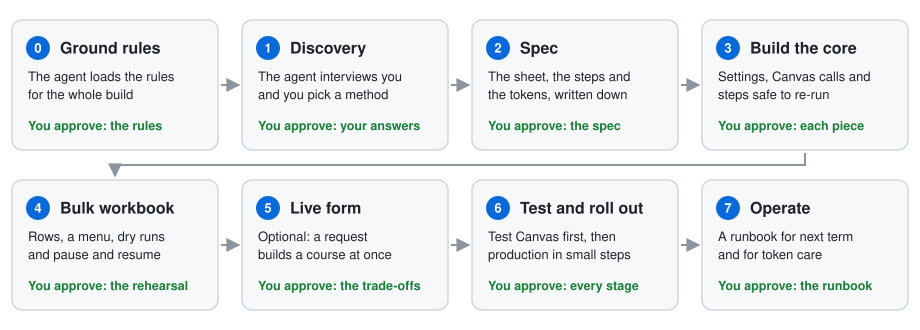

# canvas-without-middleware

**Prompts that make your own AI coding agent build Canvas course set-up on tools you already have: a Google Sheet, Apps Script and, if you want one, a Google Form.**

This is a prompt kit, not a program. You paste the prompts into an AI coding agent, such as
Claude Code, Cursor or Codex. It interviews you, writes a spec, and builds the scripts for **your**
Canvas (Instructure's learning management system) and **your** Google Workspace.

## The problem

Many institutions connect their student information system to Canvas with middleware, and have
developers to run it. Many do not. There, an administrator sets up each course by hand: the course,
its sections and IDs, the instructors, the tools, the copy of last term's content, the settings.

If you have Google Workspace, you already have what you need to automate that. A sheet holds the
list of courses. Apps Script, which is built into the sheet, can call the Canvas API. There is
nothing to install, no server and no extra licence.

The approach in this kit has built two terms in production, about 300 courses.

## Three ways to run it

The steps that build a course are the same in all three. What differs is when they run, and so
**how long an admin token has to exist.**

| Method | How it works | Canvas token |
| --- | --- | --- |
| **Bulk workbook** | You fill rows in a sheet and run them from a menu | Only while a run is in progress |
| **Live form** | A form submission builds the course within minutes | Present all the time |
| **Collect, then batch** | A form collects requests into the sheet; you run them together | Only while a run is in progress |

The bulk workbook is the method with production use behind it. The live form was built and tested
but never opened to teaching staff. Collect-then-batch is a recommendation and has not been built.
The discovery prompt helps you choose.

## How it works

<picture>
  <source media="(prefers-color-scheme: dark)" srcset="docs/img/kit-steps-dark.svg">
  
</picture>

Work through the files in order. Each one is a prompt you paste to the agent, and each tells the
agent when to stop and wait for you.

| Step | File | What happens | You approve |
| --- | --- | --- | --- |
| 0 | [`00-ground-rules.md`](00-ground-rules.md) | The agent loads eighteen rules for the whole build | The rules, plus your own |
| 1 | [`01-discovery.md`](01-discovery.md) | The agent interviews you and recommends a method | Your answers |
| 2 | [`02-spec.md`](02-spec.md) | The sheet layout, the steps and the tokens are written down | The spec |
| 3 | [`03-build-core.md`](03-build-core.md) | Settings, the Canvas calls and steps that are safe to re-run | Each piece |
| 4 | [`04-bulk-workbook.md`](04-bulk-workbook.md) | Rows, a menu, dry runs, pause and resume, a rehearsal reset | The rehearsal |
| 5 | [`05-live-form.md`](05-live-form.md) | Optional: a form that builds a course on submission | The trade-offs |
| 6 | [`06-test-and-rollout.md`](06-test-and-rollout.md) | Tests, an independent look, then production in small steps | Every stage |
| 7 | [`07-operate.md`](07-operate.md) | A runbook for next term and for looking after tokens | The runbook |

Paste the ground rules first, and keep them in the agent's instructions file (`CLAUDE.md` for
Claude Code, or your agent's equivalent) so they apply to every later step.

Two more things come with the prompts:

- [`LESSONS.md`](LESSONS.md): eleven things real Canvas and real Sheets did to a tool like this,
  each with what to do about it. The spec prompt makes your agent answer every one.
- [`examples/`](examples/): six short, generic Apps Script files that show the shape of things.
  They are not a working tool.

## What the rules protect

A few of the eighteen ground rules:

- **Dry run first, always.** You read what would happen before anything is created.
- **Tokens live only in Script Properties.** Never in code, a cell, a log or the chat.
- **One token per environment,** and the sheet always shows which is active.
- **A fixed list of write actions.** There is no general "send any request".
- **No deleting in production.** The rehearsal reset refuses to run there.
- **What is done is decided from evidence,** not from a status word that an error can overwrite.
- **Sharing the sheet is granting power.** Anyone who can edit it can change Canvas.

## Who this is for

- A Canvas administrator or learning-technology person with no middleware and no developers.
- Someone with Google Workspace, an AI coding agent, and the patience to answer its questions.

You do **not** need to be a programmer. You do need to read a dry run and decide whether it is
right.

It may not suit you if course requests at your institution also go to other departments, such as
rooms, the library or the office that arranges teaching assistants. A form that serves only Canvas
will not replace one that serves them all. The discovery prompt asks about this first.

## What you need

1. **An AI coding agent** that can write files and explain what to paste into Apps Script.
2. **Google Workspace,** with permission for a script to call outside addresses and send email.
3. **A Canvas test or beta environment** you may write to. Do not start on production.
4. **A Canvas API token** for the test environment first, and someone who can create one for
   production with an expiry date.
5. **Permission** from whoever owns your Canvas to create courses and enrol people through the API.

## Why prompts and not scripts

The scripts this kit came from carry one institution's sub-accounts, ID formats, roles, tools and
form wording. They would not work anywhere else, and none of them are in this repository.

A script carries the assumptions of the place it was written. Prompts carry the questions that
surface yours.

## Time and cost

- The original was written in an AI code editor in an afternoon or two, then refined over the nine
  days that followed.
- Expect most of your own time to go on answering the agent's questions and rehearsing in a test
  Canvas, which is where it should go.

## Honest limits

- **This is a method, not a product.** The agent writes your scripts. You own them, and you are
  responsible for what they do.
- **A sheet is the database.** That is fine for hundreds of courses a term. It is not a system of
  record, and edit access to it is power over Canvas.
- **Apps Script has limits** on run time and daily quotas. The kit plans around them; it cannot
  remove them.
- **It creates courses.** It does not synchronise student enrolments from a student information
  system.
- **The live form has never served real requests.** Everything said about it comes from testing.
- **Two ideas are untested:** collect-then-batch, and one form feeding a sheet per department.
- **The original had no independent review,** and one course in about 300 came out wrong.
  [`06-test-and-rollout.md`](06-test-and-rollout.md) asks you for the review the original lacked.
- **No time saving was measured.**
- **Canvas and Google change.** Ask the agent to check current documentation and to mark anything
  it could not verify.

## Credit

Written by Kamal Taynaz from two terms of real use. The full story is in
[You don't need middleware](https://taynaz.com/posts/canvas-without-middleware/) on
[taynaz.com](https://taynaz.com).

## Licence

MIT. See [LICENSE](LICENSE).
